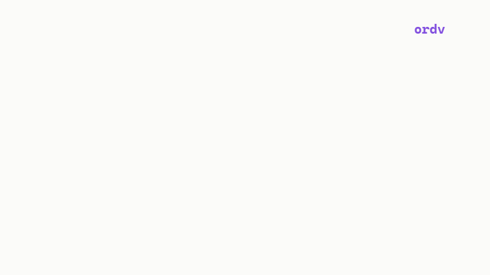

# ordv

**ordv**, from **Ord(V)**, is a local editor and CLI for selecting and ordering a Markdown graph into a human reading edition. Start with a head document or a folder, review the suggested tree, choose documents and reading order, and export a PDF.



## Start

Requires Node.js 22.12+. Installed-runtime CI covers Node 22 and 24 on Windows and Ubuntu. For CLI and agent-skill installation, see [Install the CLI and reading skill](#install-the-cli-and-reading-skill).

```powershell
npm ci
npm run dev
```

Open the localhost URL printed by the CLI. Enter a Markdown file, a folder, or a public raw Markdown URL. The editor supports graph selection, section names, parent selection, drag reordering, up/down ordering, snapshot preview, and JSON plan save/load.

For a quicker production startup:

```powershell
npm run build
npm run packet -- serve examples/notes --production
```

The example folder includes a remote link, so initial discovery can need network access. Preview and export thereafter use captured sources. **Refresh** rereads sources and remote cache while preserving the edited tree and editorial metadata. Newly unavailable selected sources block export.

## CLI

```powershell
npm run packet -- discover ./notes -o ./reading-plan.json
npm run packet -- open --plan ./reading-plan.json
npm run packet -- export ./reading-plan.json -o ./reading-packet.pdf
npm run packet -- export ./reading-plan.json --mode documents --graph -o ./document-packet.pdf
```

- A head file follows reachable Markdown links in appearance order. A folder also includes disconnected candidates and ranks likely heads: a root README first, then zero incoming links, coverage, and stable path order.
- Cycles and shared children appear once in the suggested tree. The graph retains other relationships. Reading order is the preorder traversal of the edited tree, independently of graph edges.
- Excluding a document promotes its children; it does not discard those selections. Changing the head resets the tree.
- `--refresh` on `discover` refreshes remote content. Remote cache is stored in `.reading-packet/cache` beneath the chosen folder, or the working directory for a remote head.

## PDF output

**Book** composes selected Markdown with consistent styling and page breaks between sources. **Per-document packet** renders each source separately and concatenates the PDFs with generated navigation. Select a graph node to set that document's font size and margin in per-document mode. Both modes rebuild TOC and cross-document destinations against final PDF pages.

The renderer supports tables, task lists, highlighted code, Markdown and raw HTML raster/SVG images, Korean text through system fonts, KaTeX formulas, and Mermaid diagrams. HTML images use the same bounded snapshot resolver as Markdown images. Invalid math is reported in preview and stops export before browser startup; explicitly disabling math retains literal source. Undecodable captured images stop export. It uses `vscode-markdown-pdf` as a feature reference; neither VS Code nor Obsidian is required.

A concise section/document TOC is enabled by default; heading depth is configurable. A separate relationship graph is optional (up to 30 selected documents). Its solid edges follow actual links represented in the reading tree; dashed edges show cross-links. Preview shows content; final page margins and pagination are applied on export.

PDF links remain source references. Importing or appending existing PDFs, wiki links, HTML article extraction, authenticated URLs, and desktop packaging are deferred. Omitted local Markdown references are readable labels rather than links to local files in the output. Unavailable selected documents and invalid Mermaid diagrams stop export; missing images and unresolved references produce visible notices.

## Browser setup

Puppeteer normally downloads Chromium during installation. To use an existing browser instead:

```powershell
$env:PUPPETEER_SKIP_DOWNLOAD = 'true'
npm ci
$env:ORDV_BROWSER = 'C:\Program Files (x86)\Microsoft\Edge\Application\msedge.exe'
npm run dev
```

Exports use a new temporary browser profile and close it after printing. The execution environment must permit launching the browser. See [browser overrides and runtime requirements](docs/runtime.md) if printing cannot start.

## Saved plans and local service

Version-2 JSON plans contain the selected root/input/head, document content and hashes, link graph, heading metadata, image snapshots and hashes, editable tree, ranked heads, and print settings. Text hashes cover the exact UTF-8 content stored in the snapshot after an initial BOM is removed; `sourceHash` retains the original byte hash. Source title/heading/link metadata has a separate digest. Loading or exporting a stale/tampered snapshot fails with an actionable error; ordinary reading-tree/title/order edits remain supported. Hashes detect inconsistency, not malicious forgery or source authenticity.

Valid version-1 plans are checked and upgraded when loaded. Their source byte hashes are preserved, including BOM-prefixed sources. Image and derived-metadata digests are established from the stored legacy snapshot with an explicit migration warning; original legacy images cannot be independently verified. Rediscover sources if an old plan has a mismatched text hash or metadata. Treat saved plans as copies of your source material. CLI and UI validate the same schema and export without rereading source documents or fetching network assets.

Remote Markdown is identified by its normalized final URL. Redirect aliases are retained on the document and all graph references are remapped to the canonical ID. If another alias returns changed content during one discovery, ordv keeps the first captured snapshot and reports it rather than silently mixing revisions.

The service binds to `127.0.0.1`; API requests require the token in the printed launch URL and pass host/origin checks. Source HTML is sanitized, document scripts are removed, and the preview runs in a sandboxed iframe. File reads stay within the selected root, including symlink resolution. Public HTTP(S) fetching rejects private network addresses at URL validation and socket resolution, and rechecks redirects.

Default limits: 500 discovered documents, eight remote link hops, five redirects, a 15-second fetch deadline, 5 MB per Markdown document, 15 MB per image, and 60 MB of source/asset content per snapshot. Remote resources are cached; saved plans preserve the preview/export snapshot. Fonts are platform dependent; install a Korean font on machines without one.

## Verification

```powershell
npm run build
npm test
npm run test:acceptance
npm run test:ui
npm run test:remote
```

`test:acceptance` uses deterministic remote fixture content and writes both PDFs and a saved plan under `output/acceptance`. It verifies final page references for every internal link. `test:ui` uses that plan and the production build to exercise selection, sections, preview, and HTTP export. `test:remote` separately checks a real public Markdown fetch, cache readback, and private-URL rejection.

Core modules live in `src/core`; `src/cli.ts` and `src/server.ts` expose them to command-line and editor workflows. The UI is React/React Flow; rendering uses Markdown-it, KaTeX, Mermaid, Puppeteer, and pdf-lib.

## Project direction

The source repository is [pianojay/ordv](https://github.com/pianojay/ordv). `npm run ordv -- ...` and the existing `npm run packet -- ...` invoke the same CLI.

- [Style licensing and attribution review](docs/style-licensing.md)

The packaged `ordv-reading` skill and compact agent CLI are available. MCP transport and plugin distribution remain planned; the reading skill works without them. The standalone VS Code styling preset is available by default. Follow-up work is tracked in [GitHub issues](https://github.com/pianojay/ordv/issues). Imported private lessons and generated PDFs are excluded from Git.

## Default reading style

The standalone default uses pinned VS Code and yzane Markdown PDF CSS, with the original highlight.js theme. Full third-party notices accompany the source and rendered HTML. See [licensing and compatibility](docs/style-licensing.md) for print-setting differences and redistribution requirements. Run `npm run test:style` for the layout fixture.

## Running headers and page numbers

The default print profile uses yzane’s declared A4 portrait settings: 15 mm top and 10 mm other paper margins, filename/UTC export-date headers, and packet-wide page numbers. The editor and CLI also support document-relative or combined numbering, custom margins, and explicitly supplied source-creation dates. See [marginals and print settings](docs/marginals.md) for options and provenance rules. Verify both modes with `npm run test:marginals` (Chromium and Poppler required).

## Collection and reading controls

Choose an authorized root independently of the head, record original locations for transferred collections, and review stable diagnostics, roles, supersession notes, and snapshot age. See [collection scope](docs/collection-scope.md). Roles do not silently change selection.

Tablet and duplex profiles provide annotation/binding space. Folded answers can preserve visibility, expand, or move to a source-specific appendix. Readable figures use landscape pages and overlapping vector detail tiles when needed. See [reading layouts and device validation](docs/reading.md).

## Installable CLI

`npm run build && npm pack` produces an installable tarball with compiled CLI/core, UI, styling and notices. Install with `npm install -g /path/to/ordv-0.1.0.tgz`; `ordv` then runs from any directory. Existing outputs require `--force`. See [runtime and atomic output](docs/runtime.md).

## Install the CLI and reading skill

### Prerequisites

- Git and Node.js 22.12+ with npm. The commands below build from this repository; an npm-registry release is not required.
- Chrome, Edge, or Puppeteer's downloaded Chromium for PDF printing. If you skip the browser download, configure an installed browser as shown under [Browser setup](#browser-setup).
- Fonts for your document languages. Windows normally includes Korean fonts; on Ubuntu, install `fonts-noto-cjk` when printing Korean material.
- A local agent host that can execute commands. Personal skill discovery and natural-language invocation were verified with Codex CLI on Windows. Other desktop/plugin lifecycle checks remain separate.

MCP, Python PDF inspection packages, and Poppler are not required to generate a packet. The latter tools are used by the development acceptance tests.

### 1. Build and install the CLI

Run these commands in PowerShell, bash, or zsh:

```sh
git clone https://github.com/pianojay/ordv.git
cd ordv
npm ci
npm pack
npm install --global ./ordv-0.1.0.tgz
ordv --version
```

`npm pack` runs the production build automatically. Use the tarball filename it prints if the package version changes. If you already have a checkout, start from that directory instead of cloning again. Global npm installation uses your configured npm prefix; it does not require changing agent instructions.

Open a new terminal if `ordv` is not found after installation, and check that your npm global executable directory is on `PATH`. You can then run `ordv --help` or `ordv open` from another directory. Linux also needs the browser's system libraries; see [runtime requirements](docs/runtime.md).

### 2. Register the packaged skill

The installed package contains `skills/ordv-reading/SKILL.md`, its command wrapper, and the operation reference. For Codex personal discovery, link that skill into `~/.agents/skills/ordv-reading`. Linking keeps the wrapper attached to the installed runtime and avoids a checkout-specific `ORDV_CLI` setting.

On Windows, run this in PowerShell under the same account that runs Codex:

```powershell
$ordvPackage = Join-Path (npm root --global).Trim() 'ordv'
$ordvSkillTarget = Join-Path $ordvPackage 'skills/ordv-reading'
$personalSkillRoot = Join-Path $env:USERPROFILE '.agents/skills'
$ordvSkillLink = Join-Path $personalSkillRoot 'ordv-reading'
if (!(Test-Path -LiteralPath (Join-Path $ordvSkillTarget 'SKILL.md'))) {
    throw 'Install the ordv tarball before registering its skill.'
}
if (Test-Path -LiteralPath $ordvSkillLink) {
    throw 'An ordv-reading entry already exists. Preserve it and review its target before updating.'
}
New-Item -ItemType Directory -Path $personalSkillRoot -Force | Out-Null
New-Item -ItemType Junction -Path $ordvSkillLink -Target $ordvSkillTarget
```

On Linux or macOS, the corresponding filesystem registration is:

```sh
ordv_package="$(npm root --global)/ordv"
ordv_skill="$HOME/.agents/skills/ordv-reading"
if [ ! -f "$ordv_package/skills/ordv-reading/SKILL.md" ]; then
    printf '%s\n' 'Install the ordv tarball first.'
elif [ -e "$ordv_skill" ] || [ -L "$ordv_skill" ]; then
    printf '%s\n' 'Existing ordv-reading entry preserved. Review it before updating.'
else
    mkdir -p "$HOME/.agents/skills"
    ln -s "$ordv_package/skills/ordv-reading" "$ordv_skill"
fi
```

Windows personal registration has been tested. Linux runtime installation is covered by CI; the Linux/macOS skill-registration commands describe the equivalent symlink setup, not a completed host-acceptance test. macOS runtime acceptance is not yet recorded.

If an entry already exists, inspect it before changing anything. The link target can also be a versioned user-local package installation rather than a global npm package. Keep that runtime installed while the skill points to it. Copying only the skill folder requires supplying `ORDV_CLI` as the absolute path to the installed `dist/cli.js`; see the [operation reference](docs/agent-editions.md).

### 3. Verify in a fresh agent session

Start a fresh Codex session so it can discover the personal skill. If an already-running desktop client still shows an old skill list, restart that client. Ask, for example:

> $ordv-reading Create a reading packet from the Markdown notes in this workspace. Put the experiment before the background, exclude progress logs, and save the PDF and reading plan under output/reading.

Supply your source and output folders if they are not clear from the session. The agent resolves the folders, selects and orders the documents, and calls the installed CLI. You do not need to provide snapshot JSON, special filenames, or front matter.

Successful completion returns a PDF path, a saved-plan path, the selected order/settings, and diagnostics. Check that the requested documents are included, excluded references are explained, and source files remain unchanged. The saved plan can be reopened with `ordv open --plan /path/to/reading-plan.json`.

The skill preserves source prose and uses captured snapshots for export. Public remote capture and replacing existing output require explicit permission. No MCP server, hooks, global agent instructions, or automatic document uploads are installed by this procedure.

For development verification, [CI and evidence](docs/ci.md) describes the Windows/Linux matrix. `npm run test:runtime` checks the production-only package and `npm run test:agent` checks the packaged skill wrapper. Actual host invocation is a separate check from those scripted tests.
