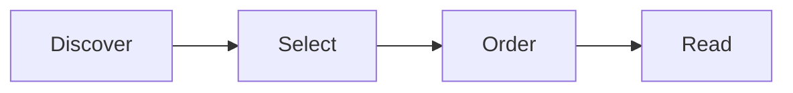

# Reading edition — 읽기 자료

This fixture checks prose, **emphasis**, and `inline code` in the default reading preset. 한국어 문장이 깨지지 않고 읽기 편하게 표시되어야 합니다.

[Continue to the next document](chapter.md#shared-heading).

## Code and quotation

> A useful reading packet keeps the source hierarchy and gives diagrams enough space.

```typescript
const edition = { title: 'Ord(V)', selected: true };
console.log(edition.title);
```

## Comparison table

| Feature | Expected result |
| --- | --- |
| Local source | Offline rendering |
| Korean text | Readable glyphs |
| Navigation | Clickable destination |

## Mathematics

Inline $E = mc^2$ and a displayed equation:

$$
\sum_{i=1}^{n} i = \frac{n(n+1)}{2}
$$

## Reading graph


